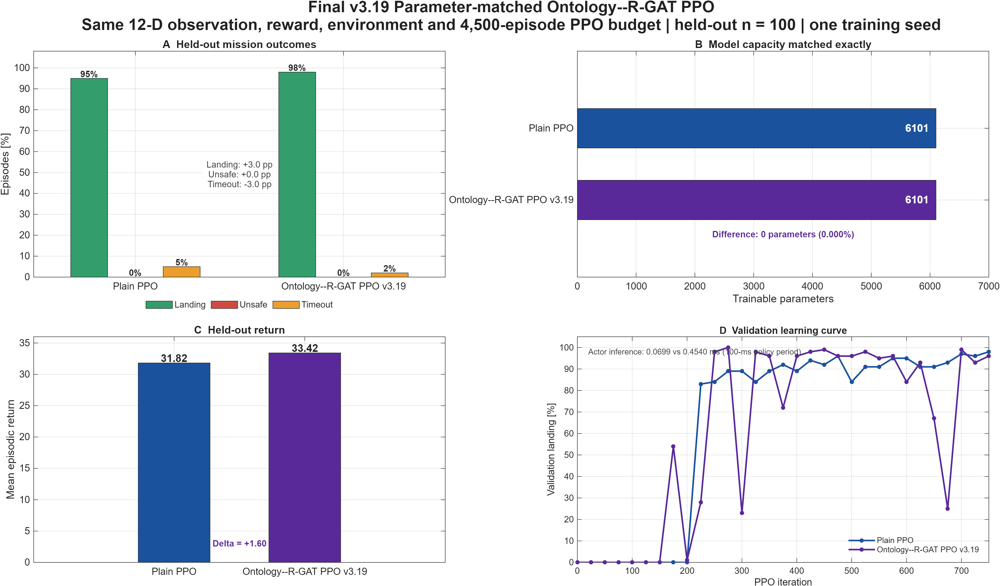
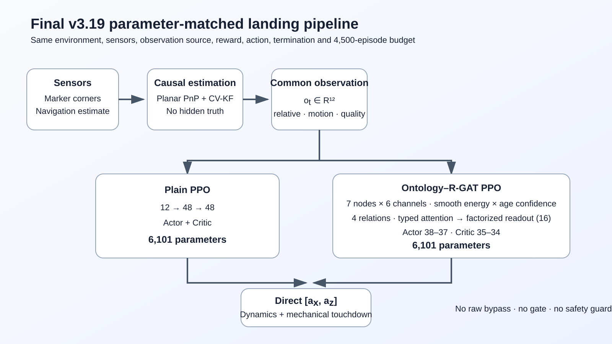
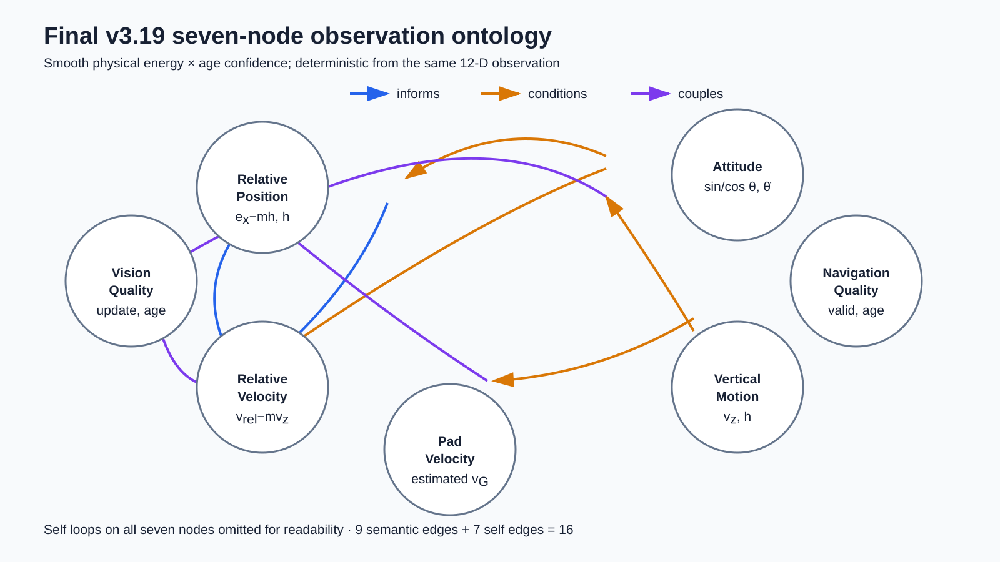

# Causal Ontology–R-GAT PPO for Moving-Platform Landing

현재 최종 버전은 평면 `planar_visibility_v2`의 온톨로지–R-GAT PPO v3.19이다. 일반 PPO와 환경, 센서, 12차원 관측 원자료, `reward_v5`, 행동, 종료, 4,500-episode PPO 예산을 동일하게 두고 Actor/Critic 상태 표현만 비교한다.



## 최종 결과

Held-out test seed 3001–3100, 방법별 100회, train seed 1:

| 지표 | 일반 PPO | 온톨로지–R-GAT PPO v3.19 | 변화 |
|---|---:|---:|---:|
| 착륙률 | 95% | **98%** | **+3%p** |
| unsafe 종료율 | 0% | **0%** | 0%p |
| timeout | 5% | **2%** | **−3%p** |
| 평균 return | 31.8186 | **33.4215** | **+1.6029** |
| trainable parameter | 6,101 | 6,101 | 동일 |
| Actor 추론 시간 | 0.0699 ms | 0.4540 ms | 정책 주기 100 ms의 0.454% |

최종 validation trajectory robustness는 20개 물리 seed × seed당 20개 paired sensor-noise 반복, 방법별 400회이다.

| 지표 | 일반 PPO | v3.19 | 변화 |
|---|---:|---:|---:|
| 착륙률 | 93.50% | **98.75%** | **+5.25%p** |
| unsafe | 0% | 0% | 0%p |
| 평균 return | 30.5741 | **33.8664** | **+3.2923** |
| 평균 위치 분산 | 4.116811 m² | **0.009430 m²** | **−99.771%** |
| 접근 곡면 법선 분산 | 0.025400 m² | **0.004580 m²** | **−81.970%** |
| 최종 상대 x 분산 | 13.793063 m² | **0.004664 m²** | **−99.966%** |

위 분산 우위는 전체 20개 validation seed 집계 결과이며 모든 개별 seed에서 우세하다는 뜻은 아니다.


## 조건부 Monte Carlo 궤적


V2015는 validation에서 선택한 어려운 물리 조건을 고정하고 동일 외생 사건 아래 센서 잡음만 1,000회 반복한 조건부 스트레스 시험이다. 전체 일반화 성능인 held-out 100회와 구분해서 해석한다.

| 지표 | 일반 PPO | v3.19 |
|---|---:|---:|
| 반복 수 | 1,000 | 1,000 |
| 착륙률 | 70.2% | **100.0%** |
| 평균 return | 20.2600 | **34.2780** |
| 평균 위치 분산 | 66.732568 m² | **0.002233 m²** |
| 접근 곡면 법선 분산 | 0.401208 m² | **0.001845 m²** |
| 평균 위치 분산 감소율 | – | **99.997%** |
| 법선 분산 감소율 | – | **99.540%** |

그림 왼쪽은 드론의 월드 절대좌표 $(x_D,z_D)$이다. 얇은 선은 두 방법이 모두 성공한 702개 paired run 중 균등 선택한 24개이며, 굵은 평균과 접근 곡면 법선 방향 ±1σ 음영은 702개 전체로 계산한다. 가로축 값은 실제 m이며 표시 종횡비만 0.15배로 압축했다. 착륙 패드는 각 방법의 평균 접지 시점 위치에 실제 폭 직사각형으로 표시했다. 오른쪽 분산은 비교 가능한 pad-relative 좌표로 계산한다.

## 최종 모델

### 공통 관측

$$
o_t=[e_x,h,v_{rel,x},\hat v_{G,x},v_z,\sin\theta,\cos\theta,\dot\theta,
I_G,\tau_G,I_D,\tau_D]^\top\in\mathbb R^{12}.
$$

- 일반 PPO: $o_t\rightarrow$ MLP 48–48
- v3.19: 동일 $o_t\rightarrow$ 7노드 × 6채널 graph $\rightarrow$ typed R-GAT(16) $\rightarrow$ factorized grouped readout(16)
- Actor: 16–38–37–2, Critic: 16–35–34–1
- 관계: `informs`, `conditions`, `couples`, `self`; 총 16간선
- raw observation bypass, action residual, descent gate, inference guard 없음
- 평면 direct policy: 안전 감독기·착륙 승인·SAFE_ABORT guard 없음





### v3.19 분산 안정화

물리 노드의 절댓값·최댓값 채널을 부드러운 제곱 에너지로 바꾸고, 등록된 영상·측위 age에 따라 연속 신뢰도 가중치

$$
c_G=\max(0,1-0.5\tau_G),\qquad
c_D=\max(0,1-0.5\tau_D)
$$

를 적용한다. 이는 정책 출력 뒤의 gate가 아니라 동일 12차원 관측으로부터 graph feature를 구성하는 추정기식 confidence weighting이다. 학습에는 인접 상태의 결정론적 행동 평균을 완만하게 잇는 on-policy temporal consistency weight 0.03을 사용한다. 파라미터 수, 정책 메모리, 보상, 환경, 행동과 종료는 변하지 않는다.

## 실행

전체 학습·validation·held-out test·그림:

```matlab
run
```

빠른 통합 검사:

```matlab
run(struct('executionMode','smoke','generatePaper',false, ...
    'figureVisible',false,'saveResults',false, ...
    'showLiveDashboard',false))
```

단일 시나리오와 실시간 비교:

```matlab
run_scenario('S3')
run_live('S3')
```

최종 조건부 Monte Carlo 그림을 화면에 유지:

```matlab
run_trajMC
```

`run_trajMC`는 같은 train seed의 PPO/R-GAT checkpoint 쌍만 허용하며 기본값은 절대궤적과 0.15배 가로 표시 스케일이다.

## 문서와 최종 자산

- [문서 색인](docs/README.md)
- [현재 시스템 단일 명세](docs/CURRENT_SYSTEM_KO.md)
- [최종 검증 결과](docs/VALIDATION_KO.md)
- [온톨로지–R-GAT 명세](docs/ONTOLOGY_GRAPH_STATE_KO.md)
- [최종 연구 보고서](docs/refactor/FINAL_REPORT.md)
- [발표자료 제작 지시서](docs/refactor/PPT_AGENT_PROMPT_KO.md)
- [최종 그림·CSV·FIG 목록](docs/assets/paper/latest_parameter_matched/README.md)

## 해석 범위

현재 결과는 2차원 시뮬레이션과 단일 학습 seed에 한정된다. held-out 성능, validation 반복 분산, 조건부 V2015 스트레스 결과를 분리해 보고하며 다중 학습 seed 통계나 형식적 안전 보장을 주장하지 않는다.
