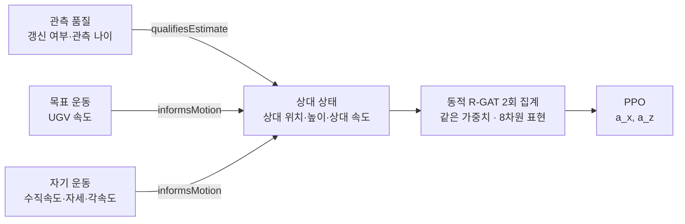

> 2026-10-26: 현재 개발 후보의 구조·비교·실행 계약은 [관계 문맥 잔차 v5](RELATIONAL_RESIDUAL_V5_KO.md)를 따른다. 이 문서는 이전 minimal v3 설계의 재현 기록이다.

# 단순화한 연구 시스템 — minimal_relational_v3.1

2026-10-24 사용자 요청에 따른 재구성. **같은 관측을 의미 관계에 맞게 연결하고 가중치를 공유하면 학습 범위 밖에서도 더 잘 착륙하는가?**를 검증한다. 현재 v3.1은 기존 2D 물리·센서·4노드를 유지하고 인코더를 동적 attention·공유 두 홉으로 변경했다. 원인·수식·검증은 [v3.1 설계](MINIMAL_V31_DESIGN_KO.md)에 있다. 귀납적 편향 자체는 점수화하지 않는다.

개발 15개 모델·9,000개 평가를 완료했으나 PPO 대비 성능 개선은 입증하지 못했다. 현재 코드의 성능 지위와 학습 안정성 문제는 [개발 결과 보고서](MINIMAL_V31_RESULTS_20261024_KO.md)를 참조한다.

## 한 장으로 보는 구조



그림에는 각 노드의 self 간선을 생략했다. 노드 특징은 같은 10차원 관측을 네 묶음에 **한 번씩만** 배치한 것이다. 자세의 sinθ·cosθ를 모두 보존한다. 숨은 참값, 접지 한계비, 제곱 특징, 별도 시야 노드, 착륙 승인 노드는 없다.

| 구성 | 이전 v2.14–v2.15 | 현재 v3.1 |
|---|---|---|
| 노드 / 의미 관계 / 전체 간선 | 7 / 4 / 20 | **4 / 2 / 7** |
| 메시지 전달 | 2층, 폭 16 | **공유 2회, 폭 8** |
| 관계 가중치 | 고정 의미 코드북 × 학습 기저 | **관계별 학습 행렬** |
| 입력 | 파생·중복 특징 포함 | **o_t의 중복 없는 분할** |
| 출력 표현 | LandingCondition의 factorized readout | **RelativeState의 최종 8차원 상태** |
| 전체 파라미터 | 비교군마다 6,101 | **비교군마다 1,419** |
| 설명용 사례 | S1–S4 및 OOD 조합 | **S1 기준 / S2 누락 / S3 가속** |

파라미터 감소는 모델 구조를 작게 만들기 위한 공통 예산 변경이다. 이전 모델과의 성능 비교 자료로 사용하지 않는다. PPO도 새 MLP로 다시 학습한다.

## 사례에서 무엇이 보여야 하는가

| 사례 | 바꾼 것 | 물리적으로 기대하는 행동 | 실패를 알아보는 방법 |
|---|---|---|---|
| S1 기준 | 없음: 등속 UGV, 외부 누락 없음 | 상대 오차를 줄이면서 하강·착륙 | 공중 정지, 지속 추종 오차, 위험 접촉 |
| S2 누락 | S1에서 3.0–3.8초 마커만 누락 | 누락 자체를 목표 가속으로 오해하지 않고 인과적 추정에 따라 추종 | 명령·궤적이 흔들리거나 추종·착륙이 악화 |
| S3 가속 | S1에서 3.0–4.5초 UGV만 가속 | 관측 가능한 속도 변화에 반응해 수평 추종 회복 | 조용하지만 뒤처짐, 회복 지연, 시야 이탈 |

공통 조건은 초기 높이 6 m, UGV 초기속도 1 m/s, 제한시간 30초다. S3 가속은 0.6 m/s²다. 모두 기존 학습 범위 안이며 정책 결과로 시간·크기를 조정하지 않았다. `clean`은 **외부 누락 주입 없음**이며 센서 잡음이나 정책 때문에 생기는 시야 이탈까지 없다는 뜻은 아니다.

관계에 이름을 붙였다고 기대 행동이 자동으로 생기지는 않는다. `qualifiesEstimate`도 학습되는 메시지이며 신뢰도 필터나 강제 감쇠 규칙이 아니다. 이 세 사례는 기대 행동과 실패 원인을 읽기 쉽게 만든다. **TOSM이 그 행동을 더 잘 학습하는지는 비교 실험으로 판단한다.**

## 세 비교군이 답하는 질문

- **PPO**: 같은 10개 관측을 MLP로 직접 읽는다.
- **TOSM-RGAT PPO**: 관측 품질은 별도 관계로, 두 운동 노드는 같은 관계로 상대 상태에 전달한다.
- **Shuffled-RGAT PPO**: 같은 노드·특징·간선·파라미터에서 세 의미 간선의 관계 배치만 바꾼다. 고정 시드로 정하고 처음부터 학습한다.

이 대조는 관계 이름의 어휘 의미가 아니라 **어떤 증거끼리 관계 가중치를 공유하는가**를 검사한다. 가능한 비정상 배치는 두 가지다. 학습 가능한 모델은 잘못된 배치에도 적응할 수 있으므로 TOSM의 우월성이나 의미 관계의 필요성을 구조만으로 보장하지 않는다.

## 실행과 읽는 순서

```matlab
run_check                    % 11개 계약 검사 + 각 비교군 1 PPO update의 smoke
run                          % 기본: v3.1 개발 학습·일반화 평가
run_scenario('S2')            % 학습 시드 271의 누락 사례
run_live('S3')                % 학습 시드 271, 센서 잡음 반복의 라이브 비교
```

`run.m` 기본은 `phase='development'`, 새 개발 시드 **271–275**, 세 비교군 `train=true`다. 확인 실험은 사용자가 `phase='confirmation'`, 시드 **281–290**, 세 `train=true`로 바꾸어 새로 학습한다. `train=false`는 현재 버전 모델을 읽기만 하며 없으면 오류다.

새 결과는 `results/minimal_v31/generalization_v1/<phase>/s<시드목록>/`에 쓴다. `primaryBySeed.csv`·`primaryContrasts.csv`의 OOD 착륙률을 먼저 읽고, `generalizationBySeed.csv`·`generalizationGapBySeed.csv`로 가속·누락·잡음별 성능과 ID 대비 감소를 확인한다. 주 비교는 TOSM−Shuffled와 TOSM−PPO이며 학습 시드별 짝 차이다. 위험 접촉·추종 오차·최악 조건을 함께 읽는다. `learningBySeed.csv`는 보조 결과다.

학습 분포의 CV/CA와 외부 누락 유무는 기존처럼 독립 표본이다. 일반화는 가속 크기·누락 길이·잡음을 각각 하나씩 범위 밖으로 바꾼 세 시험이며, 각 시험에 짝지은 범위 안 참조가 있다. 개발 평가 에피소드 9001–9100, 확인 9101–9200을 사용한다. 기존 held-out·S1–S3는 `includeDiagnostics=true`로 추가한다. S4·복합 OOD·다수 probe·자동 개발 게이트는 넣지 않는다.

세부 수식은 [4노드 온톨로지](TOSM4_ONTOLOGY_KO.md), 비교·통계 기준은 [실험 설계](EXPERIMENT_DESIGN_KO.md)에 있다. 이전 구조의 기록은 [v2 설계 이력](RGAT_V2_DESIGN_KO.md)과 [보관 문서](archive/AGENTS_V2_20261024.md)에 남아 있다. 변경 직전 소스 사본과 SHA-256 목록은 `results/archive/v215_pre_rebuild_2026-10-24/`에 보존했다.

[귀납적 편향과 업데이트](INDUCTIVE_BIAS_KO.md)는 목표·자기 운동이 같은 관계 행렬을 공유하고 PPO의 기울기가 여기에 누적되는 위치를 설명한다. 현재 학습 서명은 `minimal-relational-v3.1`이며 이전 v3의 15개 모델은 보관 진단용으로만 사용한다.

기존 7노드 결정 추적 대시보드는 보관 모델용이다. 새 4노드를 7노드 그림으로 표시하지 않는다. 현재 진단은 `run_scenario`와 `run_live`의 실제 궤적·행동 비교를 사용한다.

## 보관 v3의 재구성 검증 기록

**후속 결과:** 2026-10-24 개발 시드 251–255의 본 학습·평가가 완료됐다. 아래는 재구성 당시의 실행 검증 기록이며, 성능 분석은 [최신 개발 결과](MINIMAL_V3_RESULTS_20261024_KO.md)를 참조한다.

MATLAB R2025b에서 새 구조 검사 **8/8**, 공통 코드의 기존 검사 **14/14**, 보관 7노드 추적 검사 **A01–A13**을 통과했다. 인코더의 371개 파라미터와 120개 입력 좌표에 대한 유한차분 최대 오차는 $3.9\times10^{-10}$이었다. 세 비교군 각각 1 PPO update, held-out·세 사례 평가, CSV·PNG 내보내기, 체크포인트 3개 왕복, 라이브 에피소드 6개의 일반 평가 경로와 비트 일치를 확인했다.

기록은 `results/minimal_v3_smoke.log`, `results/minimal_v3_final_regression.log`, `results/minimal_v3_legacy_regression.log`에 있다. smoke 그림은 `TEST ONLY`로 표시하고 정식 체크포인트 폴더에 저장하지 않았다. **이 실행 검증 자체는 성능 비교가 아니다.**

## 보관 v3의 일반화 평가 개정 검증 (2026-10-24)

MATLAB R2025b에서 확장 계약 **10/10**을 통과했다. 실제 PPO 손실에서 관계 변환 192개와 attention 19개의 유한차분 최대 오차는 **1.23×10⁻¹⁰**이었다. 3방법의 1 update smoke, 3요인×ID/OOD 평가, 보조 사례, CSV/PNG 출력, 체크포인트 왕복, 라이브 6에피소드의 비트 일치를 확인했다. 기존 학습 모델 **15/15**의 호환성도 확인했다.

기록은 `results/minimal_generalization_v1_check.log`, `results/minimal_generalization_v1_final.log`이다. 정식 OOD 평가·확인 학습은 실행하지 않았다. 구현 검증 수치를 일반화 개선의 근거로 쓰지 않는다. 일반화 개정 전 소스는 `results/archive/minimal_v3_pre_generalization_20261024/`에 보존했다.

현재 v3.1의 검증은 [별도 설계 §6](MINIMAL_V31_DESIGN_KO.md)에 기록한다. 11개 구조 검사·3방법 smoke·14개 공통 회귀·A01–A13을 통과했으며 성능 우위는 본 학습 후에 판단한다.
