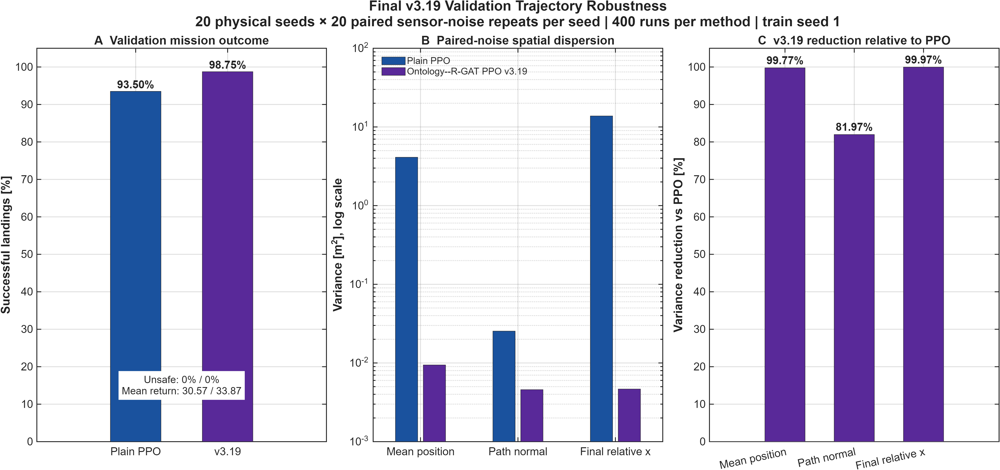
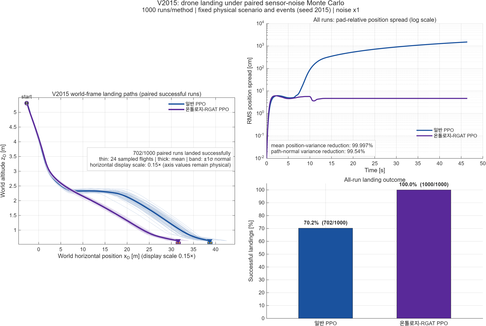

# 온톨로지–R-GAT PPO v3.19 최종 검증

## 1. Held-out mission test

Train seed 1, test seed 3001–3100, 결정론적 rollout 100회:

| 지표 | 일반 PPO | v3.19 |
|---|---:|---:|
| 착륙률 | 95% | **98%** |
| unsafe | 0% | 0% |
| timeout | 5% | **2%** |
| 평균 return | 31.818618 | **33.421549** |
| 파라미터 | 6,101 | 6,101 |
| Actor inference | 0.069894 ms | 0.453968 ms |

원자료: `heldout_test_v319.csv`, `results/planar_visibility_full_summary.csv`.

## 2. Validation trajectory robustness

물리 seed 2001–2020의 각 조건에서 동일 외생 사건과 paired sensor-noise 표본을 20회 반복했다. 방법별 총 400 rollout이다.

| 지표 | 일반 PPO | v3.19 | v3.19 변화 |
|---|---:|---:|---:|
| 착륙률 | 93.50% | **98.75%** | **+5.25%p** |
| unsafe | 0% | 0% | 0%p |
| 평균 return | 30.574075 | **33.866382** | **+3.292307** |
| 평균 위치 분산 | 4.116811 m² | **0.009430 m²** | **−99.7709%** |
| 접근 곡면 법선 분산 | 0.025400 m² | **0.004580 m²** | **−81.9697%** |
| along-track 분산 | 4.091411 m² | **0.004851 m²** | **−99.8814%** |
| 최종 상대 x 분산 | 13.793063 m² | **0.004664 m²** | **−99.9662%** |
| 착륙 시간 분산 | **0.108776 s²** | 0.709969 s² | 증가 |

종합 판정 `MeetsMissionSafetyAndDispersion=true`. 단, seed별 CSV에서 일부 쉬운 조건은 일반 PPO의 분산이 더 작으므로 “모든 조건에서 우세”로 해석하지 않는다.

## 3. V2015 조건부 sensor-noise Monte Carlo

Validation seed 2015의 물리 시나리오와 외생 사건을 고정하고 noise scale 1에서 방법별 1,000회 반복했다.

| 지표 | 일반 PPO | v3.19 |
|---|---:|---:|
| 착륙 | 702/1,000, 70.2% | **1,000/1,000, 100.0%** |
| 평균 return | 20.260012 | **34.278007** |
| 평균 위치 분산 | 66.732568 m² | **0.002233 m²** |
| 평균 위치 dispersion | 656.991 cm | **4.681 cm** |
| P95 위치 dispersion | 1,423.586 cm | **5.663 cm** |
| 최종 상대 x 표준편차 | 1,503.549 cm | **4.658 cm** |
| 접근 곡면 법선 분산 | 0.401208 m² | **0.001845 m²** |
| along-track 분산 | 66.331360 m² | **0.000389 m²** |

- 평균 위치 분산 감소: **99.9967%**
- 법선 분산 감소: **99.5402%**
- paired common-success: 702회
- 일반 PPO의 비성공 298회는 TASK_TIMEOUT

이 평가는 validation에서 식별한 어려운 단일 조건의 민감도를 보여준다. held-out 100회 성공률을 대체하지 않는다.

## 4. 플롯 해석

- 왼쪽: 드론 월드 절대좌표 $(x_D,z_D)$
- 얇은 선: 702개 paired common-success 중 균등 선택한 24개 개별 궤적
- 굵은 선: 702개 전체의 평균 절대궤적
- 음영: 702개 전체의 접근 곡면 법선 방향 ±1σ
- 패드: 평균 접지 시점의 UGV 위치에 실제 폭으로 그린 직사각형
- 가로축: 실제 m, 표시 종횡비만 0.15배
- 오른쪽 위: 모든 run의 pad-relative RMS 위치 spread
- 오른쪽 아래: 모든 run의 착륙률

절대궤적은 장면을 직관적으로 보여주고, pad-relative metric은 움직이는 착륙 지점에 대한 오차를 올바르게 비교한다.

## 5. 실행 검증

- `landing2d.orchestration.selfTest`: 13/13 PASS
- 전체 `run.m`: self-test→학습 checkpoint 적재→validation→held-out→그림 완료
- `checkcode('run_trajMC.m')`: 오류 없음
- 최종 플롯: MATLAB GUI에서 열린 상태로 육안 확인

## 6. 주장 한계

최종 결과는 단일 학습 seed와 2차원 시뮬레이션에 한정한다. 다중 학습 seed 신뢰구간, 실제 비행 안전 보장, 3차원 성능은 주장하지 않는다.
